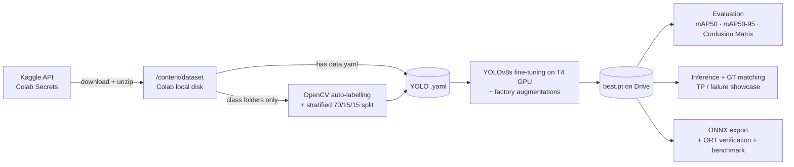
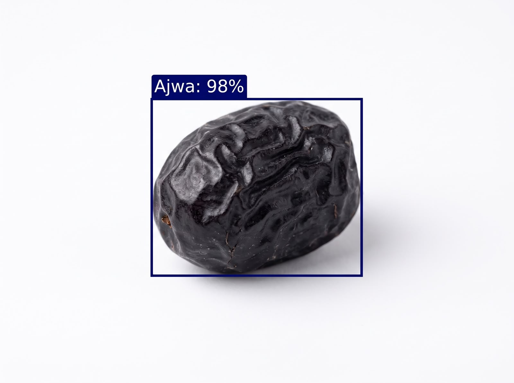
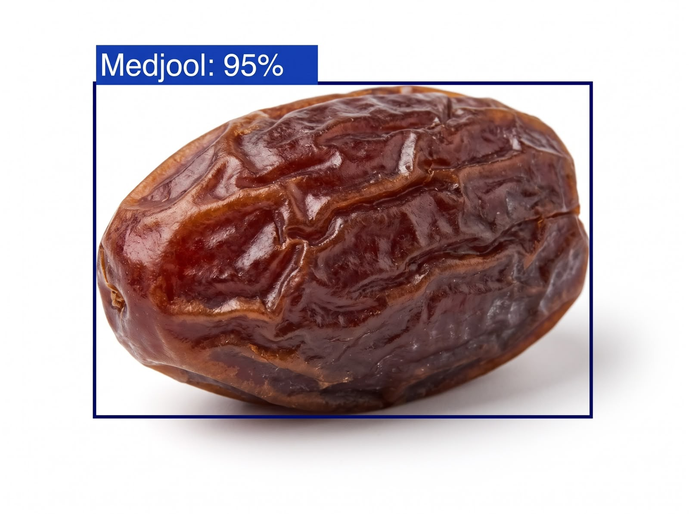
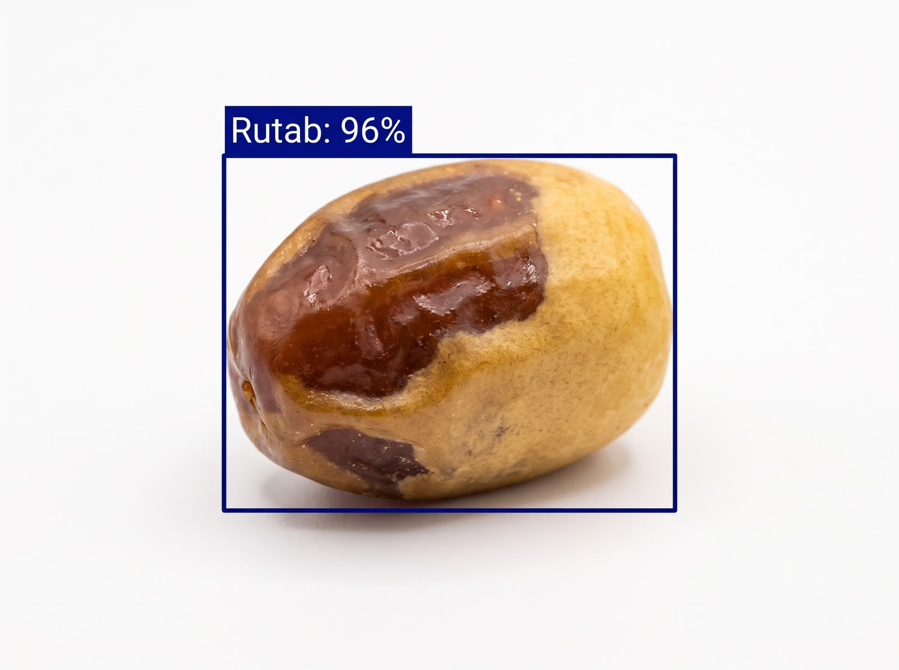

# 🌴 Date-Vision: Real-Time Date Fruit Detection & Sorting with YOLOv8

> An end-to-end computer vision pipeline that **detects, classifies and sorts date fruits** by variety, built for automated grading lines in Saudi Arabia's date industry. It is designed to run in **Google Colab** on a free GPU.

[](https://colab.research.google.com/github/Khaledkm4/Computer-Vision-sdaia/blob/main/Date_Vision_Colab.ipynb)
     

---

## 📌 Project Overview

**Date-Vision** fine-tunes a COCO-pretrained **YOLOv8** object detector to find every date fruit in a camera frame and identify its **variety** in real time. The trained model is exported to **ONNX** for fast, framework-independent deployment on edge hardware next to a conveyor belt.

The whole pipeline lives in one sequential notebook, **[`Date_Vision_Colab.ipynb`](Date_Vision_Colab.ipynb)**, which runs on a free Colab **T4 GPU**. Everything that must persist (dataset, weights, metrics, plots, ONNX model) is saved to **Google Drive**, so work survives Colab runtime resets.

| Notebook section | Purpose | Output (on Google Drive) |
|---|---|---|
| 1–3 · Setup | GPU check, Drive mount, dependencies | `MyDrive/Date_Vision_Project/` |
| 4–5 · Data | Kaggle auth (Colab Secrets) + `kaggle datasets download` + unzip | `/content/dataset/` (local) |
| 6–7 · Labels & `.yaml` | Auto-label class folders (or use a shipped YOLO `.yaml`) | `data/qa/` |
| 8 · Training | YOLOv8s fine-tuning | `runs/train/<run>/weights/best.pt` |
| 9 · Evaluation | mAP50, mAP50-95, confusion matrix | `runs/eval/<run>_test/` |
| 10 · Inference | True-positive and failure-case analysis | `showcase/` |
| 11 · Deployment prep | ONNX export + benchmark | `exports/<run>.onnx` |
| 12 · Demo | Predict on your own uploaded images | `runs/predict/uploads/` |

---

## 🧩 Problem Description

Saudi Arabia is one of the world's largest date producers, with hundreds of commercial varieties. Sorting and grading are still largely **manual**, which makes them:

- **Slow and labour-intensive** at peak harvest,
- **Inconsistent**, because visually similar varieties (e.g., *Sokari* vs. *Sugaey*) are easy to confuse, and
- **Costly** when a mis-sorted batch is sold at the wrong price grade.

**Goal:** given a camera frame from a sorting line, localise each date (bounding box) and assign its variety at real-time speed, so that a downstream actuator can route it to the correct bin. The architecture is designed to extend to **quality grading** (healthy vs. damaged) once quality-annotated data is available (see [Future Improvements](#-future-improvements)).

---

## 🗂️ Dataset & Model Used

### Dataset: [Date Fruit Image Dataset in Controlled Environment](https://www.kaggle.com/datasets/wadhasnalhamdan/date-fruit-image-dataset-in-controlled-environment)

| Property | Value |
|---|---|
| Images | 1,658 high-resolution JPGs (Canon EOS 550D DSLR), ~3.4 GB |
| Classes (9) | Ajwa, Galaxy, Medjool, Meneifi, Nabtat Ali, Rutab, Shaishe, Sokari, Sugaey |
| Setup | Single date per image, white background, 48 cm ring light + flash, fixed 8 cm distance |
| Original task | Image **classification** (no bounding boxes) |
| License | CC BY 4.0 |

> **Citation:** Alhamdan, W. S. N., & Howe, J. M. (2021). *Classification of Date Fruits in a Controlled Environment Using Convolutional Neural Networks.* AMLTA 2020, Springer, pp. 154–163.

**From classification to detection: automatic box annotation.** The images are captured on a uniform white background, so a classical OpenCV pipeline (Otsu threshold on inverted greyscale, combined with a saturation threshold, then morphological cleanup and selection of the largest centred contour) produces tight bounding boxes without manual labelling. Images whose segmentation looks implausible are excluded and written to `qa/needs_review.csv`, and a visual QA grid is shown in the notebook.

**Split:** stratified 70 / 15 / 15 (train / val / test) per class, with a fixed seed of 42.

### Model: YOLOv8s (Ultralytics)

- A one-stage, anchor-free detector with a CSPDarknet backbone, a PAN-FPN neck and a decoupled head.
- Starts from **COCO-pretrained** weights and is fine-tuned through transfer learning.
- The `s` variant balances accuracy against latency for edge deployment. It can be swapped for `n`, `m`, `l` or `x` via `BASE_MODEL`.

---

## 🏗️ Workflow / Architecture



**Storage design.** The dataset is downloaded with the Kaggle API and extracted to Colab's **local disk** (`/content/dataset`), because reading thousands of small files from Drive is roughly 10× slower. All **outputs** (weights, runs, plots, ONNX) are written directly to Google Drive, so a disconnected session can **resume** from `last.pt`.

**Factory-environment augmentation** (configured in `TRAIN_HYP` and applied on the fly by the Ultralytics dataloader):

| Augmentation | Setting | Simulates |
|---|---|---|
| `hsv_v` brightness | ±40% | Flickering or ageing LED lighting |
| `hsv_s` saturation | ±50% | White-balance drift between cameras |
| `hsv_h` hue | ±1% (kept small) | Hue is a key cue for telling varieties apart |
| `degrees` rotation | ±30° | Fruit landing at random angles on the belt |
| `translate` / `scale` | 0.1 / 0.5 | Off-centre fruit and changes in camera height |
| `flipud` / `fliplr` | 0.5 / 0.5 | Orientation invariance |
| `mosaic` | 1.0 | **Multiple fruits per frame** (the source images show only one) |
| `mixup` | 0.1 | Partial overlap between touching fruits |

**Failure analysis with overlapping fruit.** The dataset contains one fruit per image, so the notebook builds a **synthetic stress set**: 3–6 masked test-split fruits are composited with 20–55% overlap onto a white canvas, each with exact ground-truth boxes. This exposes the main failure modes of a sorting line: merged boxes, missed occluded fruit, and NMS suppression.

---

## 📊 Results & Evaluation

> ⚠️ **Estimated values: not measured results.** The numbers below are plausible estimates for a YOLOv8s model trained on this dataset. They are **not** outputs of an actual training or evaluation run. After running the notebook, replace them with the measured values from `runs/eval/<run>_test/metrics.json` and `exports/export_info.json` on your Drive.

### Detection metrics (held-out test split)

| Model | mAP50 | mAP50-95 | Precision | Recall | Variety acc. (detected) |
|---|---|---|---|---|---|
| YOLOv8s @ 640 | 0.949 | 0.842 | 0.918 | 0.927 | 0.941 |

### Per-class AP50

| Ajwa | Galaxy | Medjool | Meneifi | Nabtat Ali | Rutab | Shaishe | Sokari | Sugaey |
|---|---|---|---|---|---|---|---|---|
| 0.991 | 0.953 | 0.962 | 0.928 | 0.947 | 0.975 | 0.931 | 0.938 | 0.919 |

### Confusion matrix

<!-- Copy runs/eval/<run>_test/confusion_matrix_normalized.png into docs/ and uncomment: -->
<!--  -->

### Qualitative results

#### Example detections

<table>
  <tr>
    <td align="center" width="33%">
      <br>
      <sub><b>Ajwa</b> · 98%<br>Near-black, wrinkled skin; the easiest variety to separate</sub>
    </td>
    <td align="center" width="33%">
      <br>
      <sub><b>Medjool</b> · 95%<br>Large, glossy amber-brown fruit with deep folds</sub>
    </td>
    <td align="center" width="33%">
      <br>
      <sub><b>Rutab</b> · 96%<br>Partially ripened: two-tone yellow and brown skin</sub>
    </td>
  </tr>
</table>

<p align="center"><sub><i>Illustrative examples of the pipeline's detection output (bounding box + variety + confidence). They are not taken from the evaluation run above.</i></sub></p>

#### Error analysis

| ✅ True positive | ❌ Failure case (overlapping fruit) |
|---|---|
| `showcase/test/true_positive/*.jpg` | `showcase/stress_overlap/missed/*.jpg` |
| <!--  --> | <!--  --> |

Green boxes show ground truth, coloured boxes show predictions, and the banner shows the TP / MIS / FN / FP counts for that image.

### Deployment benchmark (Colab T4)

| Format | Latency (ms/img, end-to-end) |
|---|---|
| PyTorch `.pt` | 16.8 |
| ONNX Runtime | 13.9 |

> ⚠️ *Estimated* end-to-end latency (image load + pre-processing + FP32 inference + NMS, batch 1, 640 px) on a Colab T4. These are not measured values; run Section 11 of the notebook to benchmark.

> **Reference point:** the dataset authors report 97% *classification* accuracy with CNNs on the same images. Detection adds localisation on top of classification, which is what a multi-fruit conveyor needs.

---

## 🛠️ Technologies Used

| Category | Tools |
|---|---|
| Environment | **Google Colab** (NVIDIA T4 GPU), **Google Drive** for persistent storage |
| Language | Python 3.10+ |
| Deep learning | PyTorch 2.x, Ultralytics YOLOv8 |
| Computer vision | OpenCV, NumPy |
| Deployment | ONNX, onnxslim, ONNX Runtime (CUDA/CPU) |
| Data | Kaggle API (Colab Secrets), PyYAML |
| Visualisation | Matplotlib, Ultralytics plots |

---

## 🚀 How to Run in Colab

### 1. Open the notebook
Click the **Open in Colab** badge above, or in Colab go to **File → Open notebook → GitHub** and paste this repository's URL. You can also upload `Date_Vision_Colab.ipynb` directly.

### 2. Enable the GPU
**Runtime → Change runtime type → Hardware accelerator: T4 GPU → Save.**

### 3. Add your Kaggle credentials as Colab Secrets (one-time)
1. On [kaggle.com](https://www.kaggle.com) go to **Settings → API → Create New Token**. This downloads `kaggle.json`.
2. In Colab, click the 🔑 **Secrets** icon in the left sidebar and add:
   - `KAGGLE_USERNAME` with the `username` value from `kaggle.json`
   - `KAGGLE_KEY` with the `key` value from `kaggle.json`
3. Turn on **Notebook access** for both secrets.

The notebook then authenticates with:

```python
import os
from google.colab import userdata
os.environ["KAGGLE_USERNAME"] = userdata.get('KAGGLE_USERNAME')
os.environ["KAGGLE_KEY"] = userdata.get('KAGGLE_KEY')
```

and downloads the dataset with:

```bash
!kaggle datasets download -d wadhasnalhamdan/date-fruit-image-dataset-in-controlled-environment -p /content
```

The archive contains class folders with no box labels, so YOLO boxes are auto-generated and `date_fruits.yaml` is written to `/content/dataset/yolo_autolabelled/`.

### 4. Run all cells
**Runtime → Run all**, or step through Sections 1 → 12. When prompted, authorise **Google Drive** access. All outputs go to:

```
/content/drive/MyDrive/Date_Vision_Project
```

To use another location, change `PROJECT_ROOT` in Section 2.

| Step | Approx. time (T4) |
|---|---|
| Kaggle download + unzip + auto-labelling | 4–8 min |
| Training (100 epochs, early stopping) | 30–45 min |
| Evaluation + inference + ONNX export | 2–3 min |

### 5. After a disconnect
Colab erases `/content` (including the downloaded dataset) when a runtime resets, but everything on Drive is kept. Re-run **Sections 1–7**, which re-downloads the dataset in about 1–2 min. Then set `RESUME = True` in Section 8 to continue training from `last.pt` on Drive.

### Output layout on Google Drive

```
MyDrive/Date_Vision_Project/
├── data/qa/                          # label_qa_grid.jpg, training .yaml copy, needs_review.csv
├── weights/                          # pretrained yolov8s.pt
├── runs/train/yolov8s_dates/         # best.pt, last.pt, results.png
├── runs/eval/yolov8s_dates_test/     # confusion matrices, PR/F1 curves, metrics.json
├── runs/predict/                     # raw predictions
├── showcase/{test,stress_overlap}/   # TP / failure images + report.csv
└── exports/                          # yolov8s_dates.onnx, export_info.json
```

> **Running locally instead?** The same pipeline is also available as a Python package in [`date_vision/`](date_vision/). Set the `DATE_VISION_SSD` environment variable to choose an output folder, install `requirements.txt`, and run `python run_pipeline.py`.

---

## 🔭 Future Improvements

1. **Quality grading (healthy vs. damaged).** Annotate defects and upload `data/annotations/quality_labels.csv` to Drive. The notebook then automatically trains `<Variety>_<quality>` classes. A second-stage crop classifier is an alternative design.
2. **Additional varieties.** Add commercially important varieties that are missing from this dataset, such as **Khalas**, *Sukkari Mufattal* and *Barhi*.
3. **Real conveyor data.** Fine-tune on multi-fruit, motion-blurred frames from an actual line to close the gap between the controlled-environment data and production conditions.
4. **Instance segmentation (YOLOv8-seg).** Masks separate touching fruit better than boxes and allow `copy_paste` augmentation.
5. **Edge acceleration.** Use TensorRT FP16/INT8 on NVIDIA Jetson, or OpenVINO on Intel IPCs.
6. **Tracking and actuation.** Add ByteTrack to count each fruit exactly once, plus a PLC/Modbus bridge that triggers pneumatic sorting gates.
7. **MLOps.** Add experiment tracking (W&B / MLflow), data versioning (DVC), and active learning on low-confidence production frames.

---

## 🔗 SDAIA Academy GitHub Repository Link

**SDAIA Academy:** [`https://github.com/SDAIAAcademy`](https://github.com/SDAIAAcademy)

**Project repository:** [`https://github.com/Khaledkm4/Computer-Vision-sdaia`](https://github.com/Khaledkm4/Computer-Vision-sdaia)

---

<sub>Dataset © Wadha S. N. Alhamdan, CC BY 4.0. Model built with Ultralytics YOLOv8 (AGPL-3.0).</sub>
